# Resume Builder

Make a clean, printable A4 resume in your browser, then keep a tailored copy for every job you
apply to. Free, no sign-up, and nothing is uploaded: your resumes stay on your own computer.

**[Open Resume Builder →](https://dawsonhorvath.com/resume-generator/)**

<table>
<tr>
<td width="62%">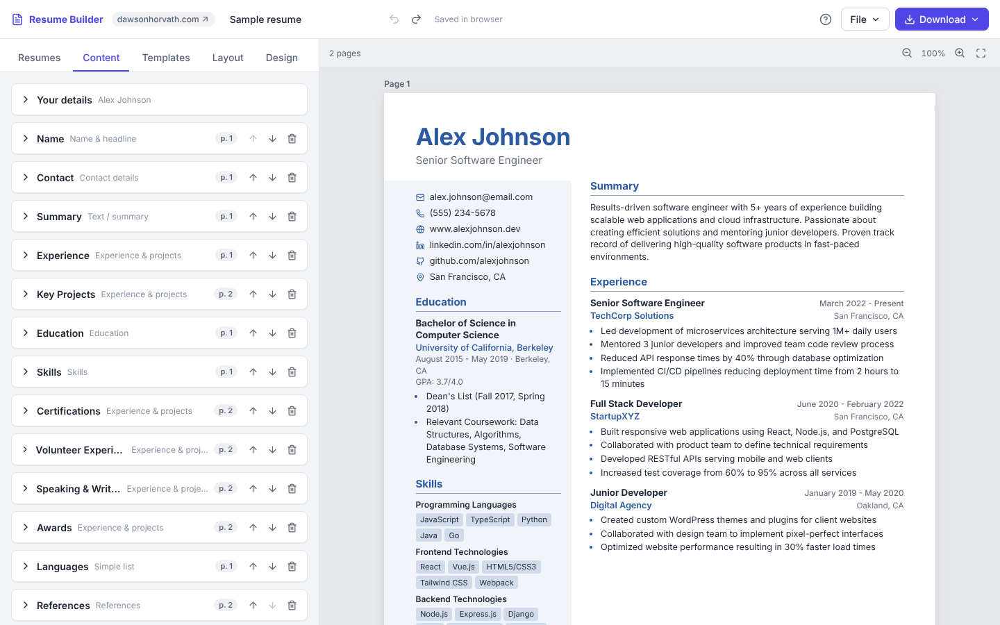</td>
<td width="38%">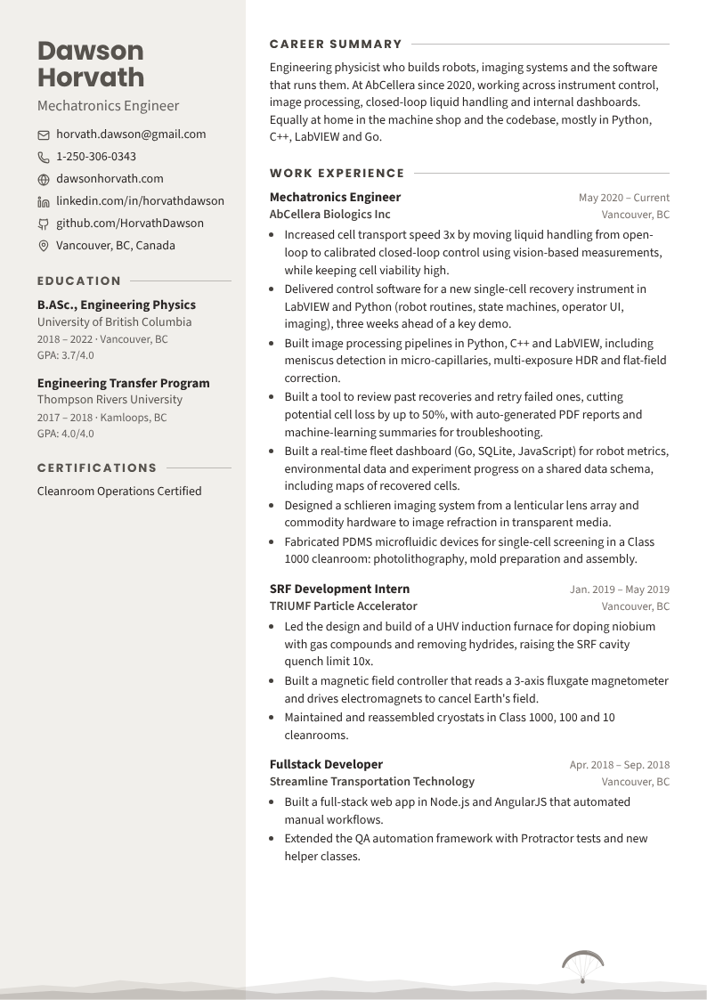<br><sub>A resume made with it (<a href="https://dawsonhorvath.com/resume-generator/?resume=dawson&mode=view">view it live</a>), Stone template.</sub></td>
</tr>
</table>

## Getting started

1. Open the app. It starts with a sample resume and a hands-on tour that builds up a practice copy step by step: adding content, rearranging the layout, adding a footer, splitting a section across pages, copying a resume for a job and saving your work (the **?** button replays it).
2. On **Content**, replace the sample with your details and experience.
3. On **Templates**, click through the designs: each one previews your own resume, and nothing
   changes until you click **Apply**.
4. Click **Download → PDF**.

Everything saves automatically in your browser as you go.

## Templates

Twelve designs to start from. Every font, colour, section style and footer can be changed
afterwards.

<table>
<tr>
<td align="center" valign="top" width="25%">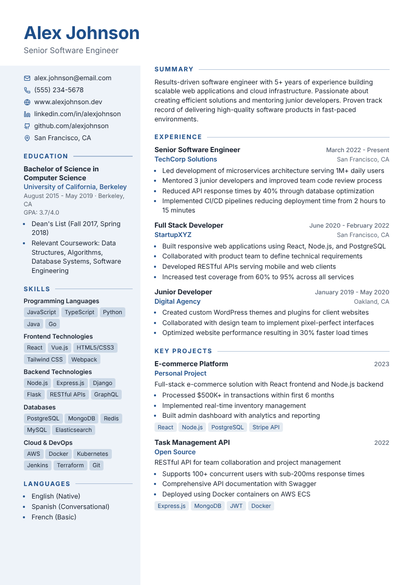<br><b>Sidebar</b><br><sub>Tinted side column for contact and skills</sub></td>
<td align="center" valign="top" width="25%">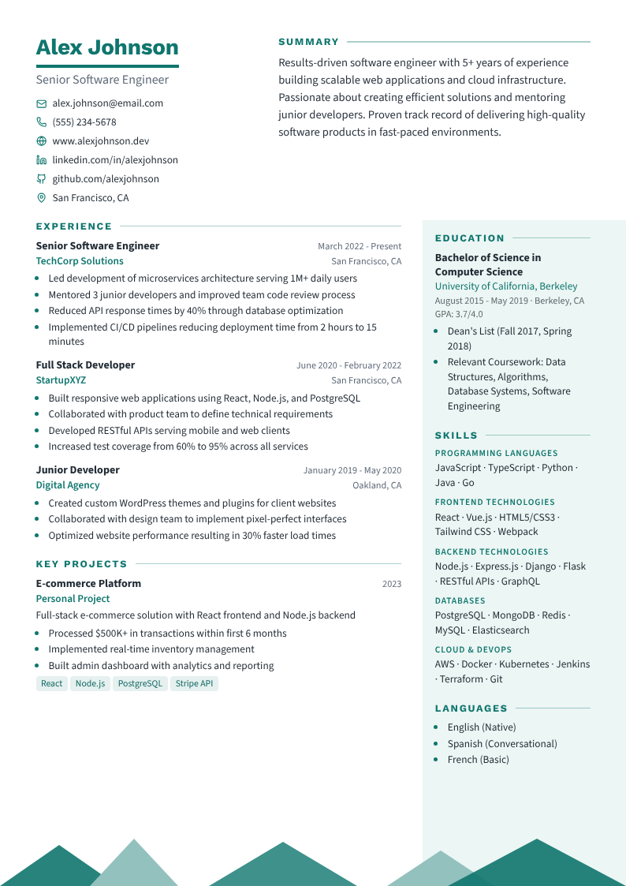<br><b>Split header</b><br><sub>Name beside your summary, mountain footer</sub></td>
<td align="center" valign="top" width="25%">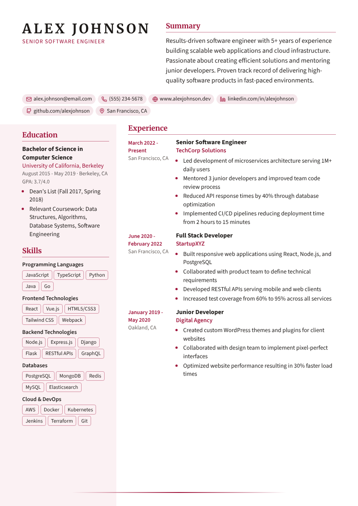<br><b>Headline</b><br><sub>Short pitch, contact pills, dates in the margin</sub></td>
<td align="center" valign="top" width="25%">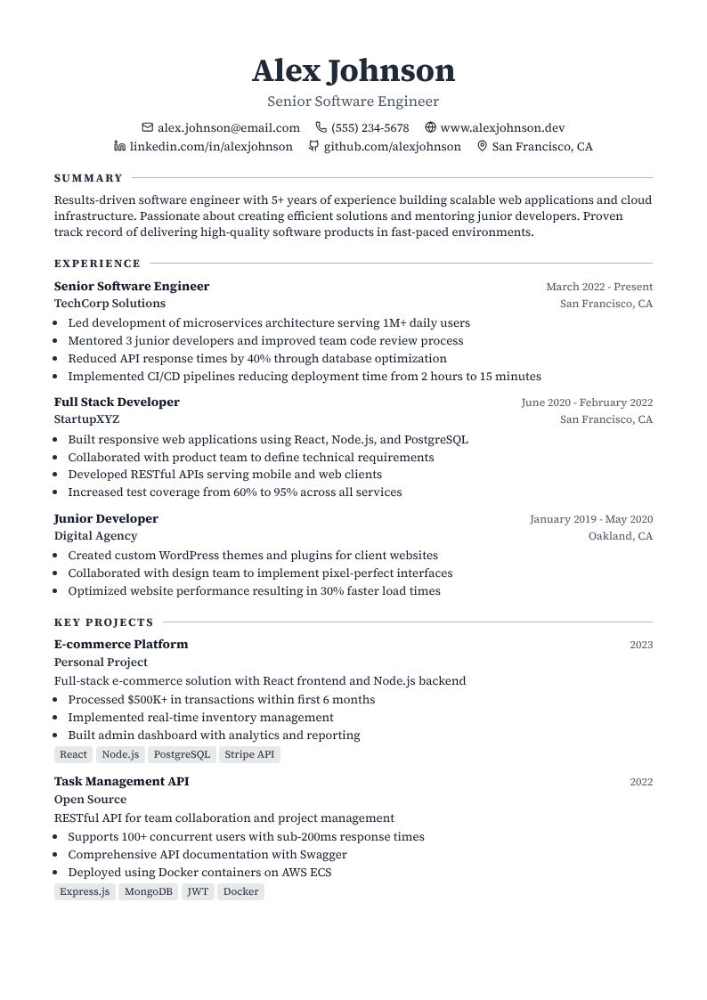<br><b>Classic</b><br><sub>One serif column, safe for any applicant system</sub></td>
</tr>
<tr>
<td align="center" valign="top" width="25%">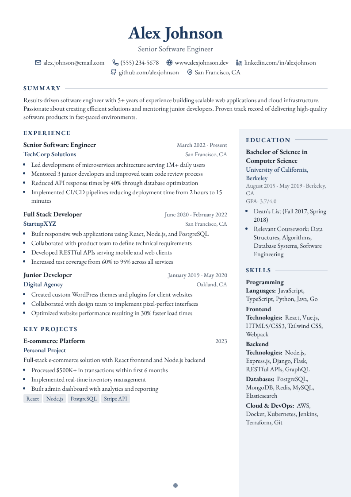<br><b>Executive</b><br><sub>Centered serif header, tinted right column</sub></td>
<td align="center" valign="top" width="25%">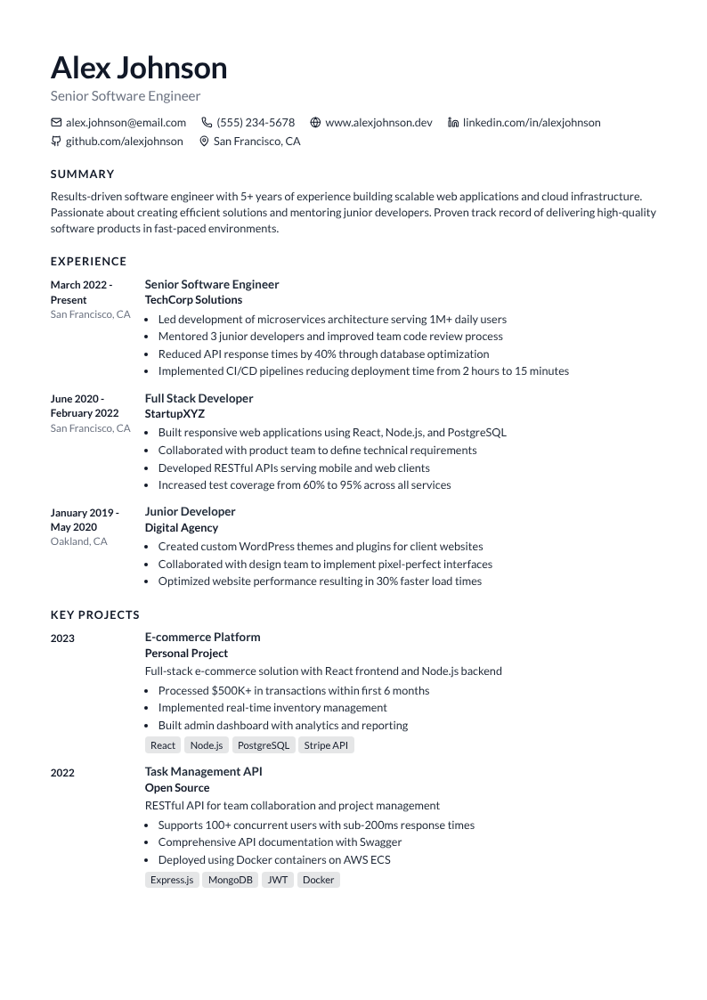<br><b>Minimal</b><br><sub>Monochrome, dates in a left margin</sub></td>
<td align="center" valign="top" width="25%">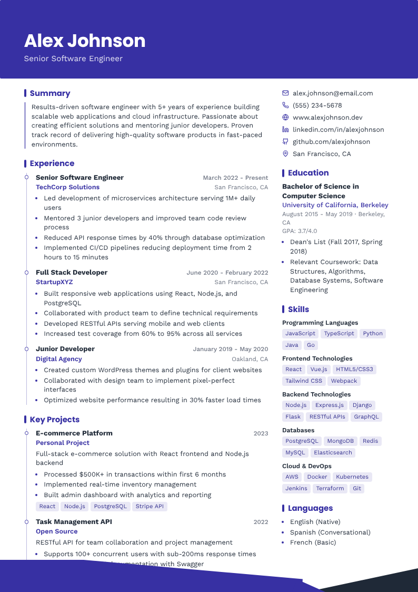<br><b>Banner</b><br><sub>Bold colour header and a timeline</sub></td>
<td align="center" valign="top" width="25%">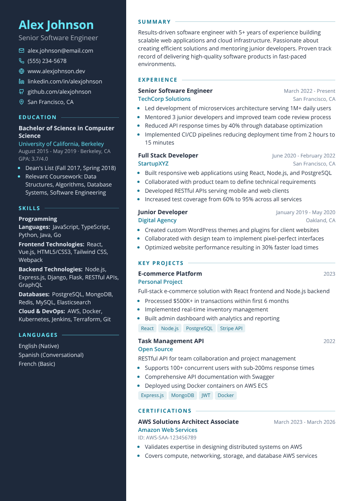<br><b>Slate</b><br><sub>Full-height dark sidebar</sub></td>
</tr>
<tr>
<td align="center" valign="top" width="25%">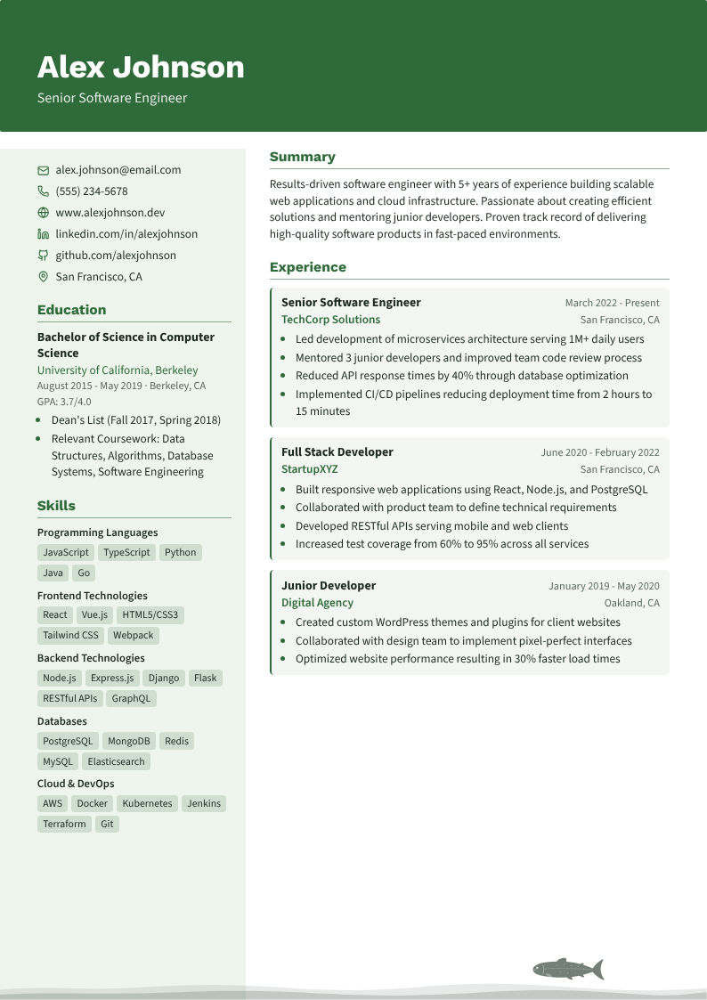<br><b>Field notes</b><br><sub>Green banner and a fish footer</sub></td>
<td align="center" valign="top" width="25%">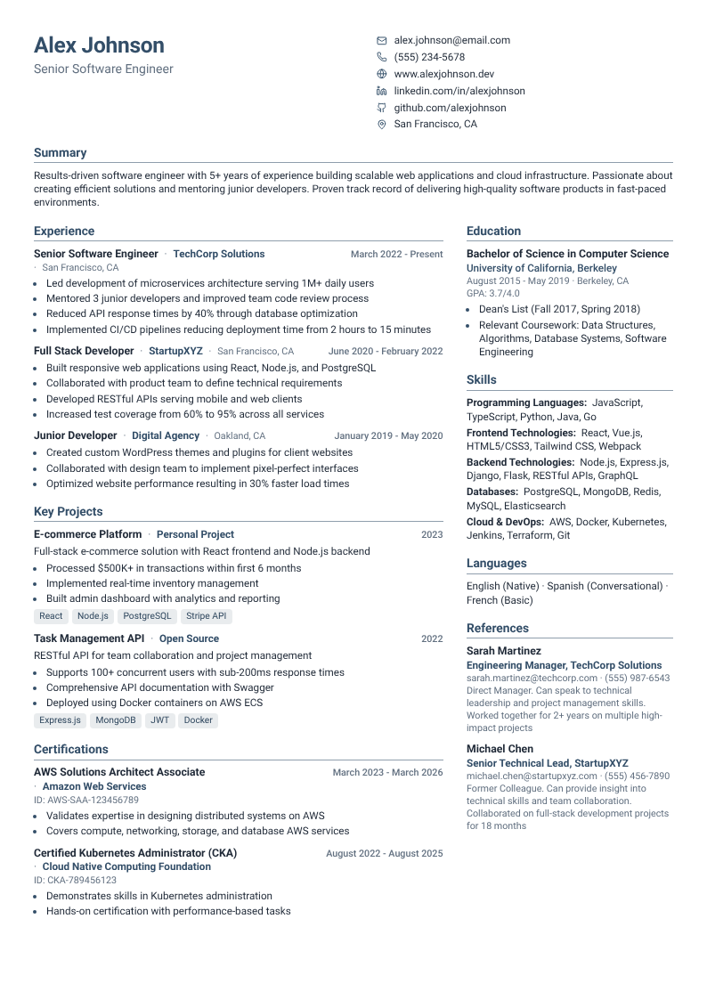<br><b>Compact</b><br><sub>Dense, fits a lot on one page</sub></td>
<td align="center" valign="top" width="25%">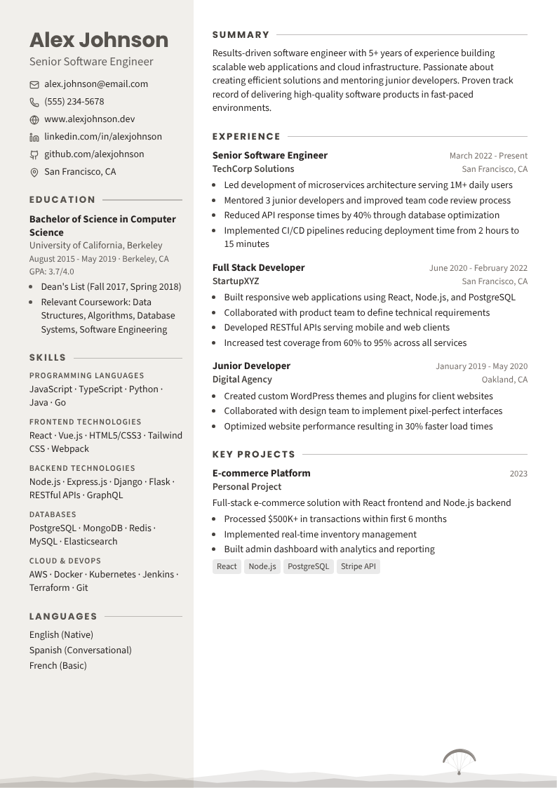<br><b>Stone</b><br><sub>Warm neutrals and a paraglider footer</sub></td>
<td align="center" valign="top" width="25%">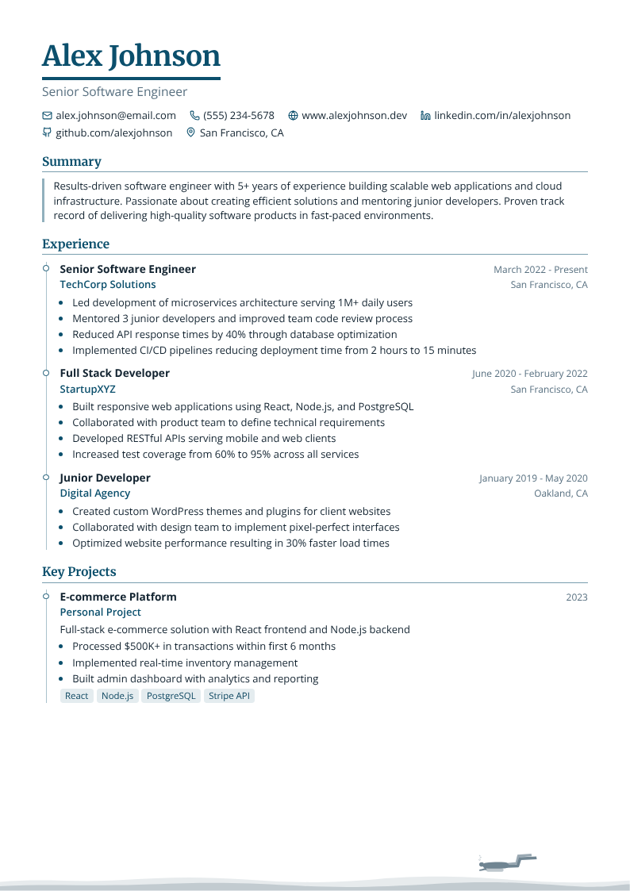<br><b>Deep</b><br><sub>Timeline column and a diver footer</sub></td>
</tr>
</table>

## What you can do

**Write once, tailor for each job.** The **Resumes** tab holds all your resumes. Use **Make a
copy for a job** to start a version for a specific application: it remembers which resume it
came from and what it's for, and folders keep things tidy (say, one folder per kind of role).

**Lay it out your way.** On **Layout**, each page is a small sheet you can rearrange: drag
sections between columns, rows and pages, change column widths, or split a long section across
two pages. If something no longer fits, the page is outlined in red and **Move it to the next
page** fixes it.

**Make it look like you.** **Templates** changes the whole design at once (tick "Keep my current
layout" to change only the look), and **Match another resume** copies the design of another
resume in your library. **Design** fine-tunes fonts, size, spacing, colours, margins and the
footer at the bottom of each page.

**Add your own footer.** Under **Design → Footer**, upload an image (PNG, JPEG, WebP or SVG), or
choose **Write HTML or SVG…** and draw one. Drawings can use the resume's colours so they follow
the theme:

```html
<svg viewBox="0 0 600 40" preserveAspectRatio="none">
  <path d="M0 40 L120 18 L240 30 L380 6 L600 40 Z" fill="var(--rg-shade)" />
  <path d="M0 40 L200 26 L420 34 L600 22 L600 40 Z" fill="var(--rg-accent)" opacity="0.6" />
</svg>
```

The colours available are `var(--rg-accent)`, `var(--rg-text)`, `var(--rg-muted)`,
`var(--rg-shade)` and `var(--rg-shade-accent)`. For safety, scripts, forms and anything loaded
from another website are removed before a footer is shown.

Undo and redo work everywhere (Ctrl+Z / Ctrl+Shift+Z).

## Getting your resume out

| | |
|---|---|
| **PDF** | **Download → PDF** saves a PDF straight away. Text stays selectable and links work. |
| **Print to PDF** | For the sharpest text: opens your browser's print dialog. Choose *Save as PDF*, margins *None*, and turn on *Background graphics*. |
| **Web page** | One self-contained HTML file you can put on any website. |
| **Resume file** | **File → Save this resume as a file** saves an editable `.resume.json`. Open it later with **File → Open file** or by dragging it onto the window. |
| **All your resumes** | **File → Download library** saves every resume in one `.library.json` file, handy for moving to another computer or browser. |

## Where your resumes are kept

By default they're saved in your browser, on your computer only. Nothing is sent to a server.
Clearing your browser's site data would remove them, so download a copy now and then.

**Or keep them in a folder (Chrome and Edge).** **File → Set up a resume folder…** saves your
resumes as files in a folder you choose and keeps it up to date:

```
library.json                        library name and which resume is the main one
resumes/main.resume.json            one file per resume
resumes/applications/acme.resume.json
README.md                           how to use the folder, including with git
AGENTS.md                           instructions for AI assistants
resume.schema.json                  the file format, for tools that check it
```

That makes it easy to:

- **Keep a history with git.** Put the folder in a private repository to see what changed and
  what you sent where (the folder's README has a simple workflow).
- **Let an AI assistant help.** Point an assistant at the folder and ask, for example, "make a
  copy of my main resume tailored to this job posting". `AGENTS.md` explains the format and
  tells it never to invent experience. Switch back to the builder and the new resume appears.

Changes made in the folder by other programs show up in the builder within a few seconds; if
you were editing the same resume, you're asked which version to keep. Next visit, your browser
asks once to reopen the folder.

## Sharing a link to a resume

A resume can be opened straight from a link, which is handy for a personal website:

| Add to the app's address | What it shows |
|---|---|
| `?resume=https://example.com/me.json` | your resume (from any site that allows it) in the editor |
| `…&mode=view` | read-only, with **Download** and **Edit in the builder** buttons |
| `…&mode=embed` | just the pages, sized to fit a frame and scrolling a page at a time, for embedding with an `<iframe>`; clicking opens the full view |

Opening a link never replaces a visitor's own resumes; theirs stay in their library.

## Running your own copy

It's a static web app (React + TypeScript + Vite), so it can be hosted anywhere.

```bash
npm install
npm run dev      # http://localhost:5173
npm test
npm run lint
npm run build    # writes dist/resume-generator/
```

The build uses relative paths, so it works at any address. Set `RG_SITE_URL` (its public
address) and `RG_HOME_URL` (the "back to site" link) when building. Resumes placed in
`public/resumes/<name>.json` can be opened with `?resume=<name>`. The included `wrangler.jsonc` deploys it
as a Cloudflare Worker (`npm run preview` runs that locally).

## Adding templates, footers and section styles

Each is a small change, and the editor menus, file format and AI guide pick it up automatically:

- **A template** is one entry in `TEMPLATES` (`src/model/templates.ts`): colours and fonts, a
  style for each kind of section, how sections are arranged, and a footer.
- **A footer:** add its id to `FooterType` (`src/model/types.ts`), list it in `FOOTERS` and
  `FOOTER_HEIGHT` (`src/model/variants.ts`), and draw it in `src/resume/Footer.tsx`.
- **A section style:** add it to `SECTION_VARIANTS` (`src/model/variants.ts`). Sections render with
  the classes `rg-<type> rg-<type>--<style>`, so CSS in `src/resume/resume.css` is often enough;
  for different markup, see `src/resume/sections.tsx`.

`npm test` checks that every template, footer and style still makes a valid resume file, and
`node scripts/readme-images.cjs` (with Playwright, and `npm run preview` running) refreshes the
screenshots in this README.

<details>
<summary>How the code is organised</summary>

```
src/
├── model/      the resume document: types, file open/save, templates, styles, auto-fit
├── resume/     draws a resume (the preview, printing and exports share it)
├── editor/     the Resumes, Content, Templates, Layout and Design panels
├── library/    several resumes, folders on disk, the AI guide and file schema
├── export/     PDF and HTML export
└── data/sample.json
```

A resume file is the `ResumeDocument` type in `src/model/types.ts`, tagged
`"schema": "resume-generator"` with a version number. Files from older versions of the app still
open.

</details>
